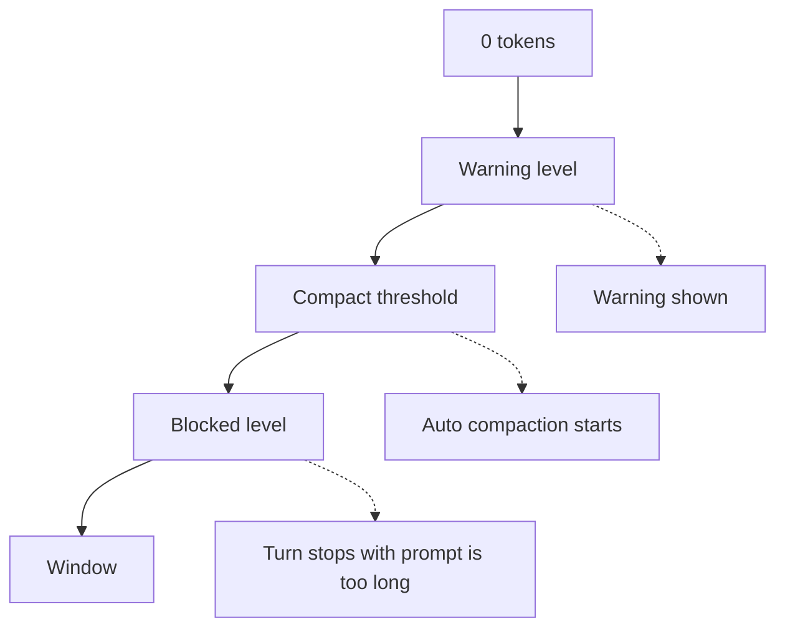
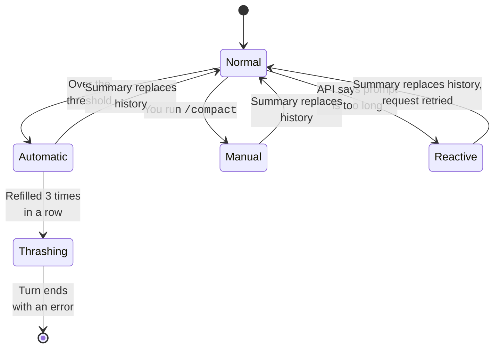

The context window is the amount of text the model can read at one time.
When a session gets close to the limit, Claude Code compacts it.
It asks the model for a summary. Then it continues from the summary.
You can set when this happens. You can also say what the summary must keep.

## What Fills the Context

Sources: [How Claude Code Works: The Context Window](https://code.claude.com/docs/en/how-claude-code-works#the-context-window) and [Explore the Context Window](https://code.claude.com/docs/en/context-window).

| Content | Status | Note |
| --- | --- | --- |
| System prompt and tool names | <Documented /> | MCP tool schemas stay deferred until a tool search loads them. |
| `CLAUDE.md`, rules, and auto memory | <Documented /> | The first 200 lines or 25 KB of `MEMORY.md` load. |
| Skill descriptions | <Documented /> | The body of a skill loads only when the skill runs. |
| Messages, tool results, and file reads | <Documented /> | This is the part that grows. |
| Attachments that Claude Code adds | <Undocumented /> | A transcript of 2.1.305 from a stub run shows types such as `total_tokens_reminder`, `output_style`, `nested_memory`, and `skill_listing`. Transcripts of 2.1.305 from a real machine also showed `queued_command`, `edited_text_file`, `deferred_tools_record`, `mcp_instructions_delta`, `credential_org`, and `silent_turn_reminder`. |

The mod event `prompt.attachment` can rewrite or drop one attachment.
For measured token counts of an empty session and ways to shrink it, see [Context Budget](context-budget.md).

## When Compaction Runs

Let `window` be the window of the model, or the window you set.
Let `out` be the smaller of the model output limit and `20000`.



| Level | Status | Formula | Example for a 1,000,000 window |
| --- | --- | --- | --- |
| Effective window | <Undocumented /> | `window - out` | 980,000 |
| Compact threshold | <Documented /> | `effective - 13000` | 967,000, which the docs call "about 967K" |
| Warning | <Undocumented /> | `threshold - 20000` | 947,000 |
| Blocked | <Undocumented /> | `window - out - 3000` | 977,000 |
| Percent override | <Documented /> | The smaller of `floor(effective * pct / 100)` and `effective - 13000` | `CLAUDE_AUTOCOMPACT_PCT_OVERRIDE` sets `pct` above 0 and up to 100 |

When auto-compaction is off, the warning level is `effective - 20000` and the compact level never applies.
The blocked level is checked first, then compact, then warning (the program).
Source: the program (`chunk-qd604jgh.js@1550773`).

At the blocked level, Claude Code stops the turn with a "prompt is too long" error, unless it can recover by compacting.
`CLAUDE_CODE_BLOCKING_LIMIT_OVERRIDE` (<Undocumented />) replaces the blocked level.

Claude Code finds the window in this order:

1. `CLAUDE_CODE_AUTO_COMPACT_WINDOW`
2. The setting `autoCompactWindow` (for one model in `modelSettings`)
3. Client data from the server
4. An experiment
5. The default of the model

The accepted window is from 100K to 1M tokens.

Since `2.1.312`, the `autoCompactWindow` of a subagent also lowers a window that `CLAUDE_CODE_AUTO_COMPACT_WINDOW` sets. Before, the variable ended the search and the subagent value had no effect.
The subagent value is a ceiling. If the window found is larger than the ceiling, Claude Code uses the ceiling (limited by the model window). It never raises the window.
Source: the program (`chunk-r5cyd28m.js` line 83915 and `chunk-1wgxyh0t.js` line 6088).
Sources: [Model Configuration: Context Window and Auto-Compaction](https://code.claude.com/docs/en/model-config#context-window-and-auto-compaction) and the program.

## Controls

Sources: [Model Configuration: Set the Auto-Compact Window](https://code.claude.com/docs/en/model-config#set-the-auto-compact-window) and [Environment Variables](https://code.claude.com/docs/en/env-vars).

| Item | Status | Effect |
| --- | --- | --- |
| `/compact [focus]` | <Documented /> | Compacts now. `DISABLE_COMPACT` removes it. |
| `/autocompact <size\|auto>` | <Documented /> | Saves the window for the current model. |
| `--autocompact <auto\|tokens>` | <Documented /> | Sets the window for one launch. |
| `autoCompactWindow`, `autoCompactEnabled` | <Documented /> | Settings. `autoCompactWindow` also works in the frontmatter of a subagent. |
| `CLAUDE_CODE_AUTO_COMPACT_WINDOW` | <Documented /> | Sets the window. It wins over the command, the flag, and the setting. Accepts `k` and `M` suffixes since 2.1.304. |
| `CLAUDE_AUTOCOMPACT_PCT_OVERRIDE` | <Documented /> | Sets the percent of the effective window. |
| `DISABLE_AUTO_COMPACT`, `DISABLE_COMPACT` | <Documented /> | Turn off automatic compaction, or all compaction. |
| `CLAUDE_CODE_MAX_CONTEXT_TOKENS` | <Documented /> | Sets the window for a model ID that Claude Code does not know. |
| `CLAUDE_CODE_DISABLE_UNKNOWN_MODEL_WINDOW_ENFORCEMENT` | <Documented /> | Compacts only after the API says the prompt is too long. |
| `CLAUDE_CODE_DISABLE_1M_CONTEXT` | <Documented /> | Turns off the 1M choice. |
| `idleCompaction`, `CLAUDE_CODE_IDLE_COMPACT_MIN_TOKENS` | <Documented /> | Compact a conversation that is idle. `idleCompaction` defaults to `true`. Set it to `false` to stop idle compaction. |
| `/rewind`, then Summarize from here or up to here | <Documented /> | Compacts one part of the conversation. |
| `/clear` | <Documented /> | Starts with an empty context. |
| `PreCompact`, `PostCompact` hooks | <Documented /> | Run around a compaction. The `trigger` field is `auto` or `manual`. |

## Kinds of Compaction



| Kind | Status | How it works |
| --- | --- | --- |
| Automatic | <Documented /> | It starts at the compact threshold. The hooks `PreCompact` and `PostCompact` get `trigger: auto`. |
| Manual | <Documented /> | It starts with `/compact`. The trigger is `manual`. |
| Reactive | <Undocumented /> | The API refuses a request as too long, and Claude Code compacts and tries again. Since `2.1.311`, this also covers a standard-window session that goes over 200K tokens and gets "Usage credits required for 1M context" (`chunk-8qajn51r.js:6009`). It compacts and continues. |
| Precomputed | <Undocumented /> | A summary made ahead of time replaces the conversation. |
| Larger-model retry | <Undocumented /> | Claude Code can try the compaction first on a model with a larger window. If that fails, the normal compaction runs. |
| Server side | <Undocumented /> | The beta `context-management-2025-06-27` lets the API edit the context. |

Since `2.1.311`, when the model's reply to a compaction request has no `<summary>` block, Claude Code usually asks once more for the summary before it replaces the conversation (`chunk-2ht8z368.js:108786`).
The second request adds a short note that says the reply must hold the summary in `<summary>` tags (`chunk-2ht8z368.js:108553`).
If the second reply has none either, the compaction fails with `no <summary> block in the second reply either` (`chunk-2ht8z368.js:108779`).
A gate in the program decides whether the second ask runs, so "usually" is the right word (`chunk-2ht8z368.js:108784`).
Source: the [Claude Code changelog](https://code.claude.com/docs/en/changelog) and the program.

## Gates and Retries

Source: the program (`chunk-qd604jgh.js@1556935` to `@2455980`). All rows are <Undocumented /> unless a note says otherwise.

| Item | What it does |
| --- | --- |
| When it checks | The query loop calls the auto-compaction check once per pass, before it builds the next model request (`chunk-n6xbt9zz.js`). It does not check after each tool result of one batch. A batch of large results can push the context over the limit before the next check. |
| Skip checks | Auto-compaction does nothing when `DISABLE_COMPACT` is set, when `autoCompactEnabled` is `false`, or when the level is below `compact`. |
| Failure breaker | After 3 failed auto-compactions in a row, the check returns without a new try. |
| Rapid-refill breaker | A refill within 3 turns of the last compaction adds 1 to a counter. Any later refill resets it. At 3, auto-compaction stops with the `Autocompact is thrashing` error. |
| Fixed prefix check | When the system prompt and tools alone are over the threshold, Claude Code logs `compaction cannot help` and goes on. |
| Reactive route | A window that is not the model default, an overflow in the auto mode classifier, or a compaction that already names a model (the larger-model retry) routes the compaction through the reactive path, not the plain one. The path needs a query source, so a call with none takes the plain path. The reactive path may ask for a last-resort compaction only when the context is at the blocked level or the classifier overflowed (`chunk-qd604jgh.js`). |
| Precompute | `precomputeCompactionEnabled` (default `true`, needs auto-compact on) lets Claude Code write the summary ahead of time. The path also needs a server gate. It starts earlier than the compact threshold, at `effective - round(effective * fraction)` or the compact threshold, whichever is smaller. |
| Cold compaction | `CLAUDE_CODE_COLD_COMPACT` makes auto-compaction send the full history in a plain request. It sets `stripNonEssential`, which turns off the request that shares the prompt cache prefix. |
| Larger-model retry | This runs before the normal compaction, not after it. The gate needs at least these: the compaction names no model yet, no earlier auto-compaction failed in a row, the model of the latest assistant reply has a larger window than the current model, and the context is at the blocked level. The attempt gets 1 API try. If it fails, the normal compaction runs next (`chunk-qd604jgh.js`). |
| Prompt-too-long retry | When the compaction request itself is too long, Claude Code drops the oldest message groups and sends it again. `compactionApiAttemptsLeft` caps the API attempts. At 0 the retry stops. |
| Second ask | A reply with no `<summary>` block gets one more request. |

## Server-Side Clearing

The API beta `context-management-2025-06-27` can clear old tool results.
Claude Code sends the edit `clear_tool_uses_20250919` with a trigger on the count of tool uses, a number of recent tool uses to keep, and a minimum of input tokens to clear.
The reply carries `applied_edits`. Claude Code adds up `cleared_input_tokens` of each such edit, and it never counts more than its own estimate.
The count lowers the token total that the threshold check uses (it logs `serverCleared`).
A cleared result shows the text `[Old tool result content cleared]` (the program).
The summary prompt tells the model to report only that the output of such a call is not available.

Auto compaction stops with an error when the context refills within 3 turns of the last compaction, 3 times in a row.
The message starts `Autocompact is thrashing`.
Sources: [How Claude Code Works: When Context Fills Up](https://code.claude.com/docs/en/how-claude-code-works#when-context-fills-up) and [Troubleshooting](https://code.claude.com/docs/en/troubleshooting).

## The Summary Prompt

The compaction request asks the model for a summary in `<summary>` tags with nine parts.
Source: the program (<Undocumented />).

1. Primary Request and Intent
2. Key Technical Concepts
3. Files and Code Sections
4. Errors and Fixes
5. Problem Solving
6. All User Messages
7. Pending Tasks
8. Current Work
9. Optional Next Step

The prompt has three forms. One is short ("in 2000 words or fewer"). One asks for an `<analysis>` first. One covers only the recent messages.
The request uses the thinking setting of the session (v2.1.198 or later).
See the captured [compaction prompt](../prompts/context-and-memory/compact.md).

## What Survives

Source: [Explore the Context Window: What Survives Compaction](https://code.claude.com/docs/en/context-window#what-survives-compaction).

| Content | Status | After compaction |
| --- | --- | --- |
| System prompt and output style | <Documented /> | They still apply. |
| Root `CLAUDE.md`, unscoped rules, and auto memory | <Documented /> | Claude Code reads them again from disk. |
| The plan from plan mode | <Documented /> | Claude Code reads it again from disk. |
| Rules with `paths:` and nested `CLAUDE.md` files | <Documented /> | They load again when needed. |
| Files that the session read or edited | <Documented /> | Claude Code reads up to five again, newest first. A file over 5,000 tokens comes back as a path. |
| Skills that ran | <Documented /> | Each keeps 5,000 tokens, up to 25,000 in total. The oldest go first. |
| Background commands and subagents | <Documented /> | They keep running. |
| `SessionStart` hooks with the `compact` matcher | <Documented /> | They run again. |

:::note[Spinner after Compaction]
In `2.1.316`, when automatic compaction runs in the middle of a turn, the spinner can show `Running SessionStart hooks…` until the turn ends. The turn keeps working. The spinner store sets that text on `hooks_start`, and only `compact_end` and the end-of-turn reset clear it. It has no case for the end of the hooks, so the `SessionStart` run after `compact_end` leaves the text up (the program, `chunk-21856tx9.js`). A claudetto session saw it.
:::

## Example

Your session is long. You start a new task.
Run `/compact focus on the auth bug fix` to keep what matters.
Or compact earlier next time by setting a smaller window.

```bash
claude --autocompact 500000
```

```json title="~/.claude/settings.json"
{
  "$schema": "https://clawdipedia.cc/schemas/claude-code-settings.json",
  "autoCompactWindow": 500000
}
```

## Errors

Each row is a family of messages. The backticked text is the start that every message in the family shares. A row marked `Various` gathers the messages of one feature that do not share one start.

| Start of Message | Status | What It Means | Cases |
| --- | --- | --- | --- |
| Various | <Undocumented /> | **Compaction.** A compaction did not run or failed. | There are no messages to compact, or not enough. The compaction was canceled. Claude Code could not reduce the conversation below the limit. Attached media exceeds size limits. The model policy blocks the swap. |

## Related Pages

- [Sessions and Storage](sessions-and-storage.md)
- [Request and Cache](request-and-cache.md)
- [Models](models.md)
- [The Agent Loop](agent-loop.md)
- [Hooks](../extend/hooks/index.md) and [Settings](../configure/settings/index.md) pages in Extend and Configure.
