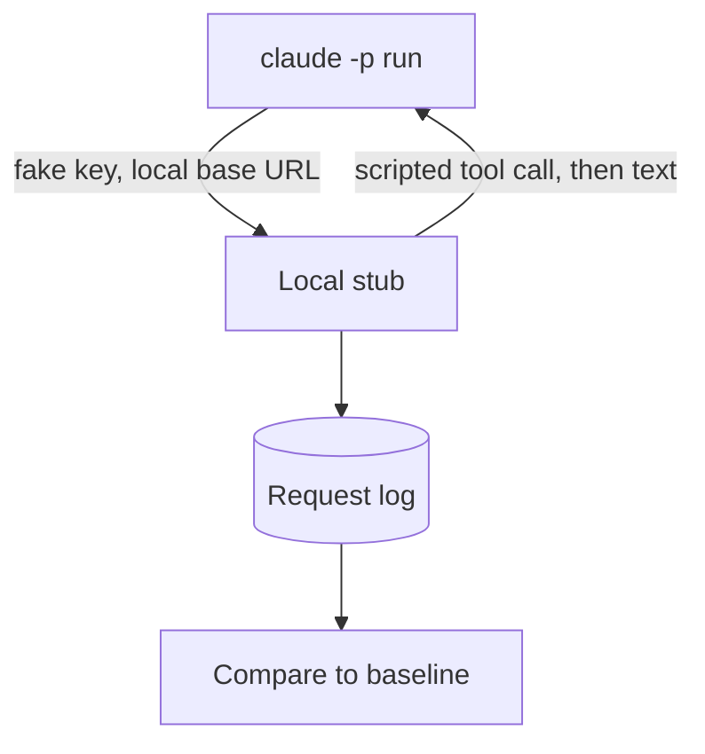

A probe is a small test that runs Claude Code `2.1.305` and checks what one setting changes.
The probes ran against a local stub of the Messages API, so they cost nothing and sent no data to Anthropic.
They show which environment variables and settings have an effect that you can see.

## How We Probed

1. We ran the unmodified `2.1.305` program with `claude -p "Reply with 'OK'." --output-format stream-json --verbose`. Every probe used that prompt.
2. We gave each run a fresh config folder, a fresh home folder, a fake API key, and a base URL that points to the local stub.
3. We turned off telemetry and other optional traffic. We pointed the proxy settings to a closed port, so a stray request to `api.anthropic.com` fails.
4. The stub answered `POST /v1/messages` as a stream or as JSON. It sent one scripted tool call and then the plain text `OK`. It wrote the method, path, headers, and body of each request to a log.
5. We made two baselines. The first was a plain run. The second ran a `Bash` tool call with command hooks on five events and a local plugin with a skill, a hook, and an MCP server. Two repeat runs of each baseline were identical after we removed ids, paths, and times.
6. We set each of 1,506 variable names to `1` in both baselines, which gave 3,012 runs. The names came from the program itself. We listed every upper-case word in its strings that starts with `ANTHROPIC_`, `API_`, `BASH_`, `CLAUDE_`, `DISABLE_`, `ENABLE_`, `IS_`, `MAX_`, `MCP_`, `NO_`, `OTEL_`, or `USE_` and ends in a letter or digit. That gave 1,499 words, and we added 7 cut-off prefixes that end in `_` (they had no effect). Not every word is an environment variable that the program reads: the list also has shell variables such as `BASH_ARGV`. Names with other prefixes were not swept. Each run got an explicit environment with only the probe setup and the name under test, so no variable of the parent shell reached the program. One name, `ANTHROPIC_API_KEY`, was dropped, because `1` replaced the fake key. We compared headers, betas, the system prompt, tools, body fields, output events, files in the config folder, the hook log, and the environment names that hooks saw.
7. Some names got extra runs: auto mode with a `Bash` call, `--brief`, `--resume`, and the plugin variables with a plugin.
   `--brief` changed nothing that we compared, in either baseline. `--resume` with the id of an earlier run loaded that run: the request had both prompts and the first reply, and the session id stayed the same.

Every request carried the fake key. The only path called was `/v1/messages?beta=true`, except with `CLAUDE_CODE_ENABLE_GATEWAY_MODEL_DISCOVERY`, which also called `/v1/models?limit=1000`.



## Results

Of the 1,506 names, 108 had an effect that we could see: 53 are <Undocumented /> in the [Environment Variables](../configure/env-vars/index.md) pages, 2 (`CLAUDE_CODE_HOST_HTTP_PROXY_PORT` and `DISABLE_COLORS`) have no row there, and 53 are documented there. The rest had none.
We did not count 13 names whose only difference was in the environment names that hooks saw, because the program sets those names itself. The exception is `CLAUDE_CODE_SUBPROCESS_ENV_SCRUB`: its effect is real (hooks lost `ANTHROPIC_API_KEY`, `CLAUDE_CONFIG_DIR`, `GIT_CONFIG_GLOBAL`, and `CLAUDE_CODE_MESSAGING_TOKEN`), and the Static and Print row covers it. We also did not count `ANTHROPIC_BASE_URL`, `NO_PROXY`, and `CLAUDE_CONFIG_DIR`, which the probe setup sets itself.
No visible effect in print mode does not prove that a variable does nothing.
Many variables work only in other modes, in remote sessions, or with a login.
This page lists the undocumented names with a clear effect, the two documented plugin variables, and the items that differ from the docs. The other documented names with an effect, and all names with no visible effect, are left out.

### Effects and Differences

An item is <Differs /> when the result differs from the docs.
The status of an environment variable is the one on its row in the [Environment Variables](../configure/env-vars/index.md) pages. This table records only what the probe saw.

| Name | What We Set | Status | What We Saw |
| --- | --- | --- | --- |
| `--model X[1m]` | model flag | <Undocumented /> | `context-1m-2025-08-07` is added for `sonnet[1m]`, `opus[1m]`, and every `claude-*[1m]` tried, also for models with a native 1M window. Without `[1m]` it is never sent. |
| hook `type: "script"` | settings | <Differs /> | Rejected at load. Under `PostToolUse` the text is `Unknown hook type "script"; entry ignored`, and the other hooks in the file still ran. Under `PreToolUse` the text is `Unknown hook type "script" — a PreToolUse/PermissionRequest hook that cannot be loaded`. No script ran. A `PreToolUse` entry also disables the whole settings file it sits in (the `SessionStart` and `PostToolUse` command hooks in the same file did not run). |
| `CLAUDE_AGENT_SDK_VERSION` | `1` | <Undocumented /> | Adds `agent-sdk/1` (the value) to the user agent. |
| `CLAUDE_CODE_ACTION` | `1` | <Undocumented /> | Sets the entrypoint to `claude-code-github-action` in the billing header and the user agent, and adds `claude-code-guide` to the agent list. |
| `CLAUDE_CODE_ADDITIONAL_PROTECTION` | `1` | <Undocumented /> | Adds the request header `x-anthropic-additional-protection`. |
| `CLAUDE_CODE_AMBER_ASTROLABE` | `1` | <Undocumented /> | Adds an "operating autonomously" block to the system prompt (do not ask "Shall I...?", finish the work before ending the turn). |
| `CLAUDE_CODE_ATTACHMENTS_BY_PATH` | `1` | <Undocumented /> | Adds the `SendUserFile` tool. |
| `CLAUDE_CODE_BASALT_COVE` | `1` | <Undocumented /> | Adds a "Communicating with the user" section and a code-comment rule to the system prompt. |
| `CLAUDE_CODE_BISON_CAIRN` | `1` | <Undocumented /> | Adds a "Delivering work" section to the system prompt. |
| `CLAUDE_CODE_BRIDGE_CHILD_AUTO_DEFAULT` | `1` | <Undocumented /> | Starts in `auto` permission mode (`permissionMode` in `init`). Adds the betas `dangerous-tool-use-2026-09-03` and `afk-mode-2026-01-31`, a `safeguards` body field, an auto mode reminder in the first message, and a `system/informational` event. |
| `CLAUDE_CODE_BRIEF` | `1` | <Undocumented /> <Gated note="Works only behind a feature flag or server gate" /> | Adds a "Talking to the user" section and the `SendUserMessage` tool. The reply goes through that tool, so the output has an extra tool turn. |
| `CLAUDE_CODE_CONTAINER_ID` | `1` | <Undocumented /> | Adds the request header `x-claude-remote-container-id`. |
| `CLAUDE_CODE_COORDINATOR_MODE` | `1` | <Undocumented /> <Gated note="Works only behind a feature flag or server gate" /> | The tool list shrinks to `Agent`, `ListAgents`, `SendMessage`, `Skill`, `TaskStop`, and `Workflow`. The only agent is `worker`. The beta `advanced-tool-use-2025-11-20` is not sent, and the first message lists the worker tools. |
| `CLAUDE_CODE_DISABLE_CLAUDE_API_SKILL` | `1` | <Undocumented /> | Removes the `claude-api` skill from the skill list and the slash commands. |
| `CLAUDE_CODE_DISABLE_REFUSAL_RETRY` | `1` | <Undocumented /> | Adds the beta `fallback-credit-2026-06-01`. |
| `CLAUDE_CODE_EMIT_STARTUP_TIMING` | `1` | <Undocumented /> | Adds `startup_timing` to the `init` event. |
| `CLAUDE_CODE_EMIT_TOOL_USE_SUMMARIES` | `1` | <Undocumented /> | Adds `tool_use_summary` events after a tool runs. |
| `CLAUDE_CODE_ENABLE_EXPERIMENTAL_ADVISOR_TOOL` | `1` | <Undocumented /> <Gated note="A feature flag or server gate decides by default. This variable overrides it" /> <Experimental /> | Adds the beta `advisor-tool-2026-03-01` and an `advisor` slash command. |
| `CLAUDE_CODE_ENABLE_REFRESH_MCP_TOOLS` | `1` | <Undocumented /> | Adds the `RefreshMcpTools` tool (seen with a plugin MCP server configured). |
| `CLAUDE_CODE_ENABLE_TOKEN_USAGE_ATTACHMENT` | `1` | <Undocumented /> | Adds a line `Token usage: 0/980000; 980000 remaining` to the first message. |
| `CLAUDE_CODE_ENTRYPOINT` | `1` | <Undocumented /> | Sets the entrypoint in the billing header and the user agent to the value (`1` here), and adds `claude-code-guide` to the agent list. |
| `CLAUDE_CODE_FOOTER_INDICATOR` | `1` | <Undocumented /> | Adds `footer_indicator` to the `init` event. |
| `CLAUDE_CODE_HUMBLE_HAMMOCK` | `1` | <Undocumented /> <Gated note="A feature flag or server gate decides by default. This variable overrides it" /> | Adds `wire_tool_inputs` (raw `tool_use.input`) to the assistant event when a tool runs. |
| `CLAUDE_CODE_INCLUDE_PARTIAL_MESSAGES` | `1` | <Undocumented /> | Adds `stream_event` events and a `system/status` event to the output. |
| `CLAUDE_CODE_INLINE_TOOLS` | `1` | <Undocumented /> <Gated note="Works only behind a feature flag or server gate" /> | Adds the beta `inline-tools-2026-09-15` to `anthropic-beta`. |
| `CLAUDE_CODE_LANTERN_PRISM` | `1` | <Undocumented /> <Gated note="Works only behind a feature flag or server gate" /> | Adds the `skill-doctor` skill to the `init` event. |
| `CLAUDE_CODE_LARCH_CISTERN` | `1` | <Undocumented /> <Gated note="A feature flag or server gate decides by default. This variable overrides it" /> | Adds a "Corrections" section to the system prompt (avoid excessive self-correction). |
| `CLAUDE_CODE_PEWTER_OWL` | `1` | <Undocumented /> <Gated note="A feature flag or server gate decides by default. This variable overrides it" /> | Adds the `SendUserMessage` tool and a "Talking to the user" section. The reply goes through that tool, so the output has an extra tool turn. |
| `CLAUDE_CODE_PEWTER_OWL_TOOL` | `1` | <Undocumented /> <Gated note="A feature flag or server gate decides by default. This variable overrides it" /> | Adds only the `SendUserMessage` tool. |
| `CLAUDE_CODE_PLUGIN_DIRS` | a plugin folder path | <Documented /> | Loads the plugin folder like `--plugin-dir` (the plugin is in the `plugins` list in `init`). The value `1` changed nothing. |
| `CLAUDE_CODE_PROFILE_STARTUP` | `1` | <Undocumented /> | Writes a `.json` and a `.txt` file under `startup-perf/` in the config folder. |
| `CLAUDE_CODE_REMOTE_MEMORY_DIR` | `1` | <Undocumented /> | Changes the memory folder in the system prompt to the value plus `/projects/` and the project folder name (`1/projects/...` here). |
| `CLAUDE_CODE_SDK_READS_SESSION_STATE` | `1` | <Undocumented /> | Adds `system/session_state_changed` events (with `sdk_host_only`). |
| `CLAUDE_CODE_SDK_READS_STARTUP_MARKS` | `1` | <Undocumented /> | Adds `keep_alive` events with a `startup_mark` field. |
| `CLAUDE_CODE_SIMULATE_PROXY_USAGE` | `1` | <Undocumented /> | Removes the whole `anthropic-beta` header and the `thinking.display` field. |
| `CLAUDE_CODE_SKILL_PROPOSALS` | `1` | <Undocumented /> | Adds a "Saving skills" section to the system prompt (skill files are a read-only cache; point the user to claude.ai settings). |
| `CLAUDE_CODE_SKIP_PLUGIN_LOCAL_MCP_SERVERS` | `1` | <Undocumented /> | Plugin MCP servers are not started. `mcp_servers` is empty and the tool list shrinks. |
| `CLAUDE_CODE_SKIP_PLUGIN_MCP_SERVERS` | `1` | <Undocumented /> | Plugin MCP servers are not started. `mcp_servers` is empty and the tool list shrinks. |
| `CLAUDE_CODE_SYNC_PLUGIN_INSTALL` | `1` | <Documented /> | Emits `plugin_install` events (`started`, `completed`) in stream-json. |
| `CLAUDE_CODE_TETHER_LIVE` | `1` | <Undocumented /> <Gated note="A feature flag or server gate decides by default. This variable overrides it" /> | Adds the betas `mid-conversation-system-clear-at-2026-08-21` and `message-threads-2026-08-12` and a `thread` body field. |
| `CLAUDE_CODE_TOTAL_TOKENS_REMINDER_BUDGET` | `1` | <Undocumented /> | Sets the number in the `total_tokens` reminder (`1 tokens left` here). |
| `CLAUDE_CODE_TURN_UPDATES` | `1` | <Undocumented /> | Adds guidance to say what you are about to do and to end with a recap. The line "Write code that reads like the surrounding code..." is gone. |
| `CLAUDE_CODE_USE_COWORK_PLUGINS` | `1` | <Undocumented /> | User settings come from `cowork_settings.json`, so its hooks and `env` apply and those of `settings.json` do not. Plugins and marketplaces use `cowork_plugins`. `claude plugin install` writes there. |
| `CLAUDE_CODE_WILLOW_TERN` | `1` | <Undocumented /> <Gated note="A feature flag or server gate decides by default. This variable overrides it" /> | Adds a "Writing for the user" section to the system prompt. |
| `CLAUDE_COWORK_MEMORY_EXTRA_GUIDELINES` | `1` | <Undocumented /> | Appends the value to the system prompt. |
| `CLAUDE_COWORK_MEMORY_GUIDELINES` | `1` | <Undocumented /> | Replaces the memory section of the system prompt with `# auto memory` and the value. |
| `CLAUDE_COWORK_MEMORY_INDEX_CONTENT` | `1` | <Undocumented /> | Adds a message that shows the value as the content of the `MEMORY.md` auto-memory file. |
| `CLAUDE_MEMORY_STORES` | `1` | <Undocumented /> | Changes the memory section of the system prompt: it adds a 4 KB limit per memory file and drops the `MEMORY.md` pointer rule. |
| `CLAUDE_PROJECT_UUID` | `1` | <Undocumented /> <Gated note="Works only behind a feature flag or server gate" /> | Adds the `Projects` tool. |

Ten undocumented names have no row in this table. Five ended the run with the value `1`, because they need a real value: `CLAUDE_CODE_BLOCKING_LIMIT_OVERRIDE` (result `Prompt is too long`, exit code 1), `CLAUDE_CODE_CLIENT_DATA_URL` (it must be the `https://downloads.claude.ai/` address), `CLAUDE_CODE_CUSTOM_OAUTH_URL` (exit code 1), `CLAUDE_CODE_REMOTE_TOOLS_PIN_STORED_LOGIN` (exit code 78), and `CLAUDE_CODE_USE_ANTHROPIC_GOOGLE_CLOUD` (no workspace ID). `ANTHROPIC_LOG` printed that `1` must be one of `off`, `error`, `warn`, `info`, or `debug`. `CLAUDE_CODE_HOST_HTTP_PROXY_PORT`, `CLAUDE_CODE_SILENT_TURN_REMINDER_TURNS`, and `DISABLE_COLORS` changed one baseline in a way that we could not tie to the name, so we did not describe them. `CLAUDE_CODE_WEB_FETCH_AGENT` is in [Subagents and Hooks](#subagents-and-hooks).

## Request Details

- `cc_version=2.1.305.b57`: the suffix `b57` stayed the same in all runs with the prompt `Reply with 'OK'.`, on both models tried. Auto mode classifier requests carried a different suffix, `034`.
- `/v1/messages/cache_touch`: never called. On `2.1.305` with a real `CLAUDE_CODE_OAUTH_TOKEN`, `claude -p "Reply with 'OK'."` got no `anthropic-cache-keepalive` header, the request had no `cache-keepalive` beta, and no `cache_touch` call was made (seen through a local proxy that logged only paths, and a debug file). The program sends it only when the response has `anthropic-cache-keepalive: active` for a request with the `cache-keepalive-2026-09-03` beta.
  That beta needs a 1-hour cache TTL for a subscriber login, `allow_cache_keepalive`, and a server-side flag. It is also off when `ANTHROPIC_UNIX_SOCKET` is set.
  The body is `{"request_id": ...}`, and the response needs a request id. Touches repeat every 30 s by default (10 to 120).
  We ran the stub with that response header and a request id, with and without `CLAUDE_INTERNAL_FC_OVERRIDES` setting the flags. The program never sent the beta and never called the path, because the probe had no subscriber login.
  The path, the header name, the body field, and the 30 s default with its 10 to 120 range are in the program's code.
- `context-1m-2025-08-07`: added by a `[1m]` suffix, also on models with a native 1M window. Not sent without the suffix.
  The default model in this setup was `claude-opus-5-5` and it did not send the beta.
- Base betas in the plain run: `claude-code-20250219`, `interleaved-thinking-2025-05-14`, `thinking-token-count-2026-05-13`, `context-management-2025-06-27`, `per-turn-control-2026-07-01`, `mid-conversation-tool-changes-2026-07-01`, `advanced-tool-use-2025-11-20`, `effort-2025-11-24`, `thinking-display-updates-2026-08-18`.
  Up to `2.1.306` the list also had `prompt-caching-scope-2026-01-05`. `2.1.307` no longer sends it behind a custom `ANTHROPIC_BASE_URL`, such as the stub.
  A first-party connection adds `mid-conversation-system-clear-at-2026-08-21`, `thinking-binding-controls-2026-08-01`, and `cache-diagnosis-2026-04-07`, and a `diagnostics` body field.
  We tested that with the base URL `http://api.anthropic.com` and `ANTHROPIC_UNIX_SOCKET` pointing to a local socket, so nothing left the machine.

## Auto Mode

With `--permission-mode auto` and a `Bash` call, the stub got classifier requests with `xml_s1` and `xml_s2` stages.
There were five requests of each stage, because the stub's `OK` reply makes the program retry.
The debug log says `server_no_result` and falls back to billed local classifier requests.
`CLAUDE_CODE_TWO_STAGE_CLASSIFIER=1` and `CLAUDE_CODE_AUTO_MODE_SERVER=1` changed nothing. `CLAUDE_CODE_AUTO_MODE_SERVER=0` removed the `server_no_result` line from the debug log, and the stub still got the same ten requests.
These four runs gave the same results on `2.1.306`, `2.1.307`, `2.1.308`, and `2.1.309`.
The `2.1.316` capture also had five stage 1 requests with `max_tokens` 64 and five stage 2 requests with `max_tokens` 8192, all on `claude-sonnet-5`, with no `temperature` field.

The cc-inspect `code` action `cli` ran `claude auto-mode` subcommands with a fake key and a temp home, config folder, and project:

| Run | Status | Result |
| --- | --- | --- |
| `claude --settings s.json auto-mode config`, with `autoMode.allow` in `s.json` | <Documented /> | Exit 0. The output holds the rule. Same on `2.1.314` and `2.1.316` |
| `claude auto-mode config --settings s.json` | <Documented /> | Exit 1, `error: unknown option '--settings'`. Same on `2.1.314` and `2.1.316` |
| `claude auto-mode defaults` and `claude auto-mode config`, with no settings | <Documented /> | Exit 0, the same output, on `2.1.316` |

### `autoMode.classifyAllShell`

We ran `claude -p --permission-mode auto` against the stub with the command `curl -s http://127.0.0.1:9/x` and a user allow rule `Bash(curl -s http://127.0.0.1:9/x)`. The table shows whether the stub got requests that carried the classifier system prompt: `1` means the classifier ran, `0` means it did not. A classifier run sent about 10 requests per `Bash` call, because the stub's canned reply makes the program retry. A managed folder needed `sudo`, so the user ran the managed cases on `2.1.306` (managed cases `classify-*`): managed `true`, managed `false`, and managed unset, each in all 7 settings combinations.

| Settings | Classifier Requests |
| --- | --- |
| No allow rule | 1 |
| Allow rule, flag unset | 0 |
| Allow rule, user `true` or `--settings` `true` | 1 |
| Allow rule, user `false` or `--settings` `false` | 0 |
| User `false` and `--settings` `true`, or the reverse | 1 |
| Managed `false`, with user or `--settings` `true` | 1 |
| Managed `false`, with user or `--settings` `false`, or neither | 0 |
| Managed `true`, with user `false`, `--settings` `false`, or neither | 1 |

Any `true` in user, `--settings`, or managed settings turns the flag on. `false` is the same as unset. The program reads no project or local source: `true` in project settings or in local settings gave 0 classifier requests.

## Subagents and Hooks

Follow-up probes ran `2.1.305` against the same stub, with a fake key, a temp home folder, and `-p "Reply with 'OK'." --output-format stream-json --verbose`. The stub scripted `Agent`, `Workflow`, `Bash`, and `Skill` calls, so each subagent request could be logged. No login was used, so cloud paths were not run. The interactive screen has its own section below.

| What We Ran | Status | What We Saw |
| --- | --- | --- |
| `Workflow` script with `agent()`, and the model variables | <Undocumented /> | The subagent model comes from `CLAUDE_CODE_WORKFLOW_SUBAGENT_MODEL` (not `inherit`), then `CLAUDE_CODE_SUBAGENT_MODEL`, then the main model. A `model` option in `agent()` is overridden. With `CLAUDE_CODE_SUBAGENT_MODEL_FORCE`, the workflow variable is dropped. |
| `CLAUDE_CODE_WEB_FETCH_AGENT=1` | <Undocumented /> | The roster gains `web-fetch`, and `WebFetch` leaves the main session's tools. The agent has only `WebFetch`. |
| `Agent` with each built-in type | <Undocumented /> | `claude`, `Explore`, `general-purpose`, `Plan`, `statusline-setup`, and `fork` started. `claude-code-guide`, `comment-thread-analyst`, `observer`, and `workflow-subagent` gave `Agent type '...' not found` in `-p`. The interactive screen started `claude-code-guide` (see [Interactive Probes](#interactive-probes)). |
| `--append-subagent-system-prompt` | <Undocumented /> | The text is the last lines of the subagent system prompt. The env var alone changed nothing. |
| `observer` frontmatter | <Undocumented /> | Without `CLAUDE_CODE_EXPERIMENTAL_OBSERVER_AGENTS=1` no observer ran. With it, extra observer requests ran (three or five, from run to run, on `2.1.306`, `2.1.307`, `2.1.308`, and `2.1.309`), with an `ObserverReport` tool, and `observerMessage` was the last line of the digest. |
| Subscription (OAuth) login, main and `Explore` requests | <Undocumented /> | Same main system prompt text (apart from the memory folder path), same 12 default tools, and same `Explore` prompt as an API key. Different: a 1-hour cache `ttl`, `thinking.display` `updates`, the `ScheduleWakeup` description, a `schedule` skill, and `RemoteTrigger` in the deferred list. The `Explore` request had the same 7 tools: `Bash`, `ListAgents`, `Read`, `ReportFindings`, `Skill`, `DeferredToolPlaceholder`, and `ToolSearch`. See [Override a Prompt](../prompts/other/override.md). |
| Agent frontmatter spelling | <Undocumented /> | `Tools` and `disallowed-tools` were ignored. `tools` and `disallowedTools` worked. |
| `isolation: remote` in a file | <Undocumented /> | No error. The agent ran in a local worktree, like `worktree`. |
| Command hooks with `continue:false` and `systemMessage` | <Documented /> | See [Hook Input and Output](../extend/hooks/input-and-output.md#what-continue-and-systemmessage-do-per-event). |
| Setup hook `additionalContext` | <Differs note="Not in the model request." /> | It never reached the model request. |

## Configure and Memory

These checks ran `2.1.305` against the same stub, plus static reading of the program. Nothing was run with a login.

| What We Ran | Status | What We Saw |
| --- | --- | --- |
| User `outputStyle` plus a plugin style with `force-for-plugin: true` | <Undocumented /> | The system prompt used the forced plugin style. The `init` event still named the configured style. |
| `CLAUDE_CODE_REMOTE=1`, with and without `CLAUDE_CODE_REMOTE_MEMORY_DIR` | <Undocumented /> | Without the dir, the auto-memory section is missing. With it, the section returns and names the dir. |
| `CLAUDE_MEMORY_STORES` set to a JSON list | <Undocumented /> | A list such as `[{"name":"s1","path":"/some/dir"}]` kept the memory section, but it named a `memory/team/<dir name>` folder under the project folder in the config folder, marked "(shared with all users of this project)", and added a 4 KB limit note per memory file. A list of strings, `[]`, and text that was not JSON changed nothing. No `memory_*` tool was added. 2.1.304 gave the same result. |
| `claude auto-mode config` with `autoMode.allow` in each source | <Documented /> | User settings and `--settings` applied. `.claude/settings.json` and `.claude/settings.local.json` were ignored. Managed settings applied too, see [Managed Folder Probe](#managed-folder-probe). |

## Context Budget

These runs used a live subscription login on `2.1.305`, not the stub, with a fresh config folder and an empty project.

| What We Ran | Status | What We Saw |
| --- | --- | --- |
| `claude -p "/context" --output-format stream-json`, empty and after `claude -p "Reply with 'OK'."` | <Undocumented /> | An empty session held 12,524 tokens and 16,277 after `Reply with 'OK'.` (the reply was exactly `OK` in every run). The first request matched `/context` exactly. Reruns on `2.1.306`, `2.1.307`, `2.1.308`, and `2.1.309` (default model `claude-sonnet-5-5`, warm cache) had the same categories and matched again. On `2.1.307` the System tools category was 393 tokens larger than on `2.1.306`, with the same warm cache. On `2.1.309` it was 106 tokens larger than on `2.1.308`, which fits the longer `Bash` tool description. Its token counts are not quoted, because the cache was warm. See [Context Budget](../how-it-works/context-budget.md). |

## Live Login Probes

These runs used a live subscription login (`CLAUDE_CODE_OAUTH_TOKEN`) on `2.1.306`, and again on `2.1.307`, `2.1.308`, `2.1.309`, `2.1.310`, `2.1.311`, `2.1.312`, and `2.1.314` with a fresh config folder and an empty project. The results matched up to `2.1.312`. The `2.1.314` run differs in one line of the system text, which the next table explains. The request runs went through a local proxy that kept only the paths and the `anthropic-beta` header.

| What We Ran | Status | What We Saw |
| --- | --- | --- |
| `claude -p "Reply with 'OK'."` with the login, compared with the same run using a fake API key against the stub | <Undocumented /> | The main request (the first one with tools) had the same 11 body keys (`context_management`, `diagnostics`, `max_tokens`, `messages`, `metadata`, `model`, `output_config`, `stream`, `system`, `thinking`, `tools`), the same tool names, and 4 system blocks on both sides. On `2.1.307` the system text was also the same once model names, temp paths, and the per-run billing hash were masked. On `2.1.314` one line is on the key side only. The model puts it there, not the login: the key side runs Opus 5.5, which gained the [`original_games` section](../how-it-works/system-prompt.md#sections) in that release, and the login side runs Sonnet 5.5, which did not. The probe keeps no body text, so it reports the count and not the line. The login sent 15 betas and the key sent 13. Only the login sent `oauth-2025-04-20` and `extended-cache-ttl-2025-04-11`. The default model was `claude-sonnet-5-5` with the login and `claude-opus-5-5` with the key. The login run also called `GET /api/claude_code/policy_limits` (`200`) and `GET /api/claude_code/settings` (`404`). The cache was warm, so no token counts are quoted. See [Betas](api/betas.md#observed-request). |
| `/artifacts` typed in the interactive screen with the login, then Esc | <Undocumented /> | The screen showed `Unknown command: /artifacts` and no panel opened. This differs from the `2.1.305` run, where the panel opened with the same kind of login. `2.1.307`, `2.1.308`, `2.1.309`, `2.1.310`, `2.1.311`, and `2.1.312` showed the same. The run on `2.1.306` first showed it. The cause is not known. |

## Static and Print Probes

These runs used `2.1.305`, the same stub, a fake key, a temp home folder, and a dead proxy, plus static reading of the program. Nothing was run with a login or with `sudo`. The [Managed Folder Probe](#managed-folder-probe) is the one section that used `sudo`.

A hook inherits the environment of the probe, so a change in the probe environment shows as a change in the hook environment. The `2.1.311` to `2.1.312` comparison reports `AWS_EC2_METADATA_DISABLED` as new in the environment of `PreToolUse`, `PostToolUse`, `SessionStart`, `Stop`, and `UserPromptSubmit`. The probe sets that variable, so this is not a change in Claude Code. Read a hook-environment difference against `tools/release/lib/env.ts` before you record it.

| What We Ran | Status | What We Saw |
| --- | --- | --- |
| Control requests on stdin with `--input-format stream-json` | <Undocumented /> | `set_model`, `get_binary_version`, `set_permission_mode`, `mcp_status`, and `interrupt` got replies that match [Control Protocol](../extend/headless/control-protocol.md). An unknown model ID still got `success`. A bad mode got `error` with `error_code` `invalid_mode`. |
| A user agent with `mcpServers` frontmatter | <Undocumented /> | The server started with the agent and stopped when it ended. The same agent in `.claude/agents/` was skipped in an untrusted folder. |
| `claude plugin validate` with odd `version` values | <Documented /> | A string of any text passed. A number failed. An empty string counted as missing. See [Plugin Manifest](../extend/plugins/manifest.md). |
| `CLAUDE_CODE_SUBPROCESS_ENV_SCRUB` with test variables | <Undocumented /> | Credential and config names were removed. The four GitHub token variables stayed. The permission mode was forced to `default`. See [Tools and Bash Variables](../configure/env-vars/tools-and-bash.md#what-the-scrub-removes). |
| Default `-p "Reply with 'OK'."` for every model in the catalog | <Undocumented /> | Short, extended short, or full prompt by model. See [System Prompt](../how-it-works/system-prompt.md#prompt-by-model). |
| `CLAUDE_COWORK_MEMORY_*` and `CLAUDE_CODE_POST_TURN_MEMORY` | <Undocumented /> | The four Cowork variables changed the memory section as described in [Memory and Rules](../configure/memory-and-rules.md). The post-turn pass did not run locally: the log said the memory server was not mounted. |
| `PostToolUse` hook logging per tool | <Undocumented /> | The `tool_response` shapes in [Hook Events](../extend/hooks/tool-events.md#posttooluse-tool_response-shapes). |
| `claude -p "/context"` | <Undocumented /> | 24 `count_tokens` requests and no `/v1/messages` request. |
| Skill variables in the `init` skill list | <Documented /> | `CLAUDE_CODE_DISABLE_CLAUDE_API_SKILL` removed `claude-api`. The other four had no visible effect. |
| `CLAUDE_CODE_MANAGED_SETTINGS_PATH` | <Undocumented /> | Ignored. The log still read the machine default managed folder. |
| `/status` size warning with a 45,000-character `CLAUDE.md` in `-p`, `claude doctor`, and `get_status` | <Undocumented /> | No warning in these three. It shows in the interactive screen (see [Interactive Probes](#interactive-probes)). |

## Managed Folder Probe

These runs used the real `2.1.306`, `2.1.307`, `2.1.308`, `2.1.309`, `2.1.310`, `2.1.311`, and `2.1.316` binaries on macOS with the stub, a fake key, and a temp home and config folder. The managed folder `/Library/Application Support/ClaudeCode` was made with `sudo` (owner `root:wheel`). It held `CLAUDE.md`, a rule, a skill, an output style, `managed-settings.json`, a `managed-settings.d/` drop-in, and `managed-mcp.json` with one stdio server. Each run also had a user server and a project `.mcp.json` server. A baseline ran without the folder. Runs used `-p --output-format stream-json`, plus `claude mcp list` and `claude mcp get`. Every row below was seen in the managed cases of `2.1.306`, and again in all 55 cases of `2.1.307`, of `2.1.309`, of `2.1.310`, of `2.1.311`, and of `2.1.316`: `mcp-run`, `mcp-list`, `mcp-get-managed`, `mcp-get-user`, `mcp-config-flag`, `outputstyle`, `skill-default`, `skill-disabled`, `claudemd-order`, `excludes-any-claude-md-user` and `-project`, `excludes-managed-abs-user` and `-project`, `excludes-managed-glob-user` and `-project`, `agent-mcp`, and `auto-mode-config`. The `NotebookEdit` deny is in `claudemd-order`. The only data that changed in `2.1.307`, `2.1.310`, `2.1.311`, and `2.1.316` is the order in which the baseline servers started, and no row depends on it.

| What We Ran | Status | What We Saw |
| --- | --- | --- |
| `managed-mcp.json` with a user server and a project server | <Documented /> | Only the managed server started. The user and project servers were not started and not in `init` (the baseline started both). `claude mcp list` showed only the managed server. `claude mcp get` on a user server exited 1 with `No MCP server named "user_srv". Configured servers: managed_srv`. |
| `claude mcp get` on the managed server | <Undocumented /> | `Scope: Enterprise config (managed by your organization)`, and the removal hint names the `managed-mcp.json` path. |
| `--mcp-config <file>` with `managed-mcp.json` present | <Documented /> | Exit 1 with `You cannot dynamically configure MCP servers when an enterprise MCP config is present`. No `init` event. See [Servers passed with `--mcp-config`](https://code.claude.com/docs/en/managed-mcp#servers-passed-with---mcp-config-or---strict-mcp-config). |
| Managed `outputStyle` with a style file in the managed `.claude/output-styles/` | <Documented /> | The `init` event named the style and its text was in the request. It won over `outputStyle` in user settings, `.claude/settings.json`, `.claude/settings.local.json`, and `--settings`. |
| A skill in the managed `.claude/skills/`, with and without `CLAUDE_CODE_DISABLE_POLICY_SKILLS=1` | <Documented /> | The skill was listed and its description was in the request. The variable removed it. Nothing else changed. |
| Managed `CLAUDE.md` with user and project `CLAUDE.md` | <Documented /> | Order in the request: managed, then `~/.claude/CLAUDE.md`, then project `CLAUDE.md`. |
| `claudeMdExcludes` of `**/CLAUDE.md`, in user or project settings | <Documented /> | User and project `CLAUDE.md` were removed. The managed `CLAUDE.md` and the managed rule still loaded. |
| `claudeMdExcludes` of the managed absolute path, or `<managed>/**`, in user or project settings | <Documented /> | Nothing was removed: user and project `CLAUDE.md` stayed, and the managed `CLAUDE.md` and the managed rule loaded. |
| Managed `.claude/rules/*.md` | <Undocumented /> | It loaded, and `claudeMdExcludes` with `**/CLAUDE.md`, the managed absolute path, or `<managed>/**` did not remove it. |
| A `managed-settings.d/` drop-in that denies `NotebookEdit` | <Documented /> | `NotebookEdit` left the `init` event tool list (present there in the baseline). It was not in the request tool list in either run (12 tools). |
| The prompt note "not verified as your organization's policy" | <Undocumented /> | It did not appear with a root-owned folder. The program text says it is added for managed files that the session's own account could write (not run). |
| User agent with `mcpServers` frontmatter, no `--mcp-config` | <Undocumented /> | The agent ran, but its server did not start (without the managed folder it did). A notice said `probe-agent agent MCP server blocked by enterprise MCP config: agent_srv`. |
| `autoMode` in `managed-settings.json` and a `managed-settings.d/` drop-in, with `claude auto-mode config` | <Documented /> | Both files applied. Lists from all sources join, with user or `--settings` rules first and managed rules after. `$defaults` expands where it sits. A list with no `$defaults` in any source has no defaults. See [Auto Mode](../configure/permissions/auto-mode.md). |

## Interactive Probes

These runs used the real `2.1.305` binary in a pseudo-terminal (a Python `pty` driver with `pyte` to render the 200x50 screen, because tmux was not installed). The method is the same as `tmux send-keys` and `capture-pane`. The stub, the fake key, the temp home and config folders, the dead proxy, and `CLAUDE_CODE_DISABLE_NONESSENTIAL_TRAFFIC=1` were as in the other probes, with `env -i` so no variable from the parent session leaked in (the child got only the variables the probe set). Plain prompts were `Reply with 'OK'.` and the stub answered `OK`. Onboarding and trust were skipped by seeding the config file. The stub answered a `DO:{...}` line in the prompt with one scripted tool call. No login and no real credentials were used.

| What We Ran | Status | What We Saw |
| --- | --- | --- |
| `Agent` with `claude-code-guide` | <Documented /> | It started on `claude-haiku-5-5` with the tools `Bash`, `Read`, `WebFetch`, and `WebSearch`. The agent call ran in the background. The request text is the same as on 2.1.304. The program leaves it out when `CLAUDE_CODE_ENTRYPOINT` is `sdk-ts`, `sdk-py`, or `sdk-cli`, which includes `-p`. See [Subagent, Claude Code Guide](../prompts/agents/subagent-claude-code-guide.md). |
| `Agent` with other types | <Undocumented /> | Unknown types return `Agent type '<x>' not found. Available agents: claude, claude-code-guide, Explore, general-purpose, Plan, statusline-setup`. `comment-thread-analyst`, `workflow-subagent`, and `web-fetch` (default settings) gave that error. `fork` returned `Fork started`. See [Subagent Runtime](../extend/subagents/runtime.md). |
| `PermissionRequest`, `PermissionDenied`, `Notification`, and `PreCompact` hooks | <Undocumented /> | All four fired. See [Hook Input and Output](../extend/hooks/input-and-output.md#what-fires-and-what-is-honored-in-the-interactive-screen). |
| `Notification` types | <Documented /> | Seven values seen live: `permission_prompt`, `idle_prompt`, `elicitation_dialog`, `elicitation_response`, `elicitation_url_dialog`, `elicitation_complete`, and `agent_needs_input`. See [Hook Events](../extend/hooks/session-events.md#notification). |
| `Elicitation` and `ElicitationResult` hooks with an MCP server | <Undocumented /> | Both fired. Inputs had `mcp_server_name`, `message`, `mode`, and `requested_schema`, and for the result `action` and `content`. |
| `statusLine` and `subagentStatusLine` commands that log their input | <Undocumented /> | `subagentStatusLine` ran on a fixed 5-second tick and got no `COLUMNS` or `LINES`. `statusLine` got `transcript_path` from the first run and `prompt_id` after the first prompt. Runs paused under dialogs. See [Status Line](../configure/status-line.md). |
| Instruction file size warning with 45.6k, 156.0k, and four 34.4k files | <Undocumented /> | A banner under the header at start and a line in `/status`. The 40k, 120k total, and 150k (Opus 5.5) limits held. See [Memory and Rules](../configure/memory-and-rules.md). |
| `PostToolUse` hook logging for `Read`, `Write`, `Edit`, `Bash`, and an MCP tool | <Undocumented /> | Same shapes as the `-p` probe (no `contentNotInModelContext` on an `Edit` after a `Read`). On `2.1.305` an `Edit` of a file that was never read worked, and its `PostToolUse` input had `contentNotInModelContext: true`; no `PostToolUseFailure` fired. See [Hook Events](../extend/hooks/tool-events.md#posttooluse-tool_response-shapes). |
| `/usage` when the usage endpoint answers `429`, with fake subscriber credentials and a local TLS stub behind a proxy (without `CLAUDE_CODE_DISABLE_NONESSENTIAL_TRAFFIC`) | <Undocumented /> | Rerun on `2.1.305` (fake credentials, local stub): a `429` with no `Retry-After` gave `Error: Usage endpoint is rate limited until <time>.` with the time 5 minutes away, and `Retry-After: 1800` gave a time 30 minutes away. A `200` with an `error` envelope gave `Error: Usage endpoint is rate limited. Please try again in a moment.` When rate-limit headers from a model reply had filled the first rows, the panel showed `Per-model breakdown unavailable (rate limited until <time>)` (or `(rate limited — try again in a moment)` for the envelope). After one good fetch and a later `429`, it showed `Showing last-known usage as of 2m ago (rate limited until <time>)`. These texts match the `2.1.304` run. With the real `CLAUDE_CODE_OAUTH_TOKEN` on `2.1.305` (a proxy that answered `429` for the usage endpoint and passed everything else on) the usage endpoint was never called, so the texts could not be checked: the panel showed the `Current session` and `Current week` rows from reply headers, and `Refreshing…` stayed up. A claude.ai login was not tried. See [Slash Commands](../extend/skills-and-commands/slash-commands.md). With `CLAUDE_CODE_DISABLE_NONESSENTIAL_TRAFFIC` set, the panel showed `Failed to load usage data` and sent no request. Not seen on `2.1.305`: `Partial usage data`, the `(could not refresh)` variants, the form without `as of`, and the `403` path. On `2.1.306` the same real-token run was repeated with three proxy faults: a `429`, a `429` with `Retry-After: 1800`, and a `200` error envelope. The usage endpoint was again never called, so the texts are still seen only against the stub. On `2.1.307`, `2.1.308`, `2.1.309`, `2.1.310`, and `2.1.311` the same three runs gave the same result, and the program holds the same text fragments as `2.1.306`. On `2.1.312` the same three runs gave the same result: the usage endpoint was never called. The `2.1.312` program has new text, so it differs from `2.1.311`. The `200` error envelope now reads `Claude is temporarily limiting requests to the usage page (not your usage limit). Try again in a moment.` The panel suffix now reads `(requests temporarily limited — try again in a moment)`. Only the program text shows this, not a run. |
| A mod that calls `$.ui.notify` | <Undocumented /> | The hook got `message`, `title`, and `notification_type` (type `plugin_notification`), even with no notification channel. See [Hook Events](../extend/hooks/session-events.md#notification). |

### Notification Types

Follow-up probes ran the interactive screen with a hook that logs each `Notification` input. The same stub and fake key were used, with a temp home and config folder. They were rerun on `2.1.305` with `env -i`.

| What We Ran | Status | What We Saw |
| --- | --- | --- |
| `PushNotification` tool call `{message, status: "proactive"}` | <Undocumented /> <Gated note="The tool is behind a server-side flag that is off by default" /> | The hook got `session_id`, `transcript_path`, `cwd`, `prompt_id`, `hook_event_name`, `message` (`probe push`), and `notification_type` `push_notification`. No `title`. The tool result was `Terminal notification sent.` The flag is `tengu_kairos_push_notifications`. The probe forced it through cached feature flags in the temp config, with `CLAUDE_CODE_GB_DISK_CACHE_WHEN_TELEMETRY_OFF=1`, `ENABLE_TOOL_SEARCH=false` (the tool is deferred), and `CLAUDE_CODE_DISABLE_NOTIFICATION_PRESENCE_CHECK=1`. A run without the presence-check variable gave the tool result `Not sent because you're active in this terminal.` and no hook call. |
| Agent teams (`CLAUDE_CODE_EXPERIMENTAL_AGENT_TEAMS=1`), one named background teammate, and a hand-written `permission_request` in `<config>/teams/<team>/inboxes/team-lead.json` | <Undocumented /> <Gated note="Set CLAUDE_CODE_EXPERIMENTAL_AGENT_TEAMS=1 or use --agent-teams" /> | The hook got `worker_permission_prompt` with the message `A subagent needs permission for Bash` (the name part was `A subagent`, not the teammate name) and no `title`. A normal `permission_prompt` (`Claude needs your permission`) followed when the dialog showed `Bash command · from a subagent`. The lead's poller starts only when a teammate exists, and it sends the notification only when the lead is idle with no dialog shown. The network form, `<name> needs network access to <host>`, was not run (it needs a sandbox and a teammate in another process). On `2.1.305` the same hand-written `permission_request` did not work: the lead showed `Message from @mate (unverified)` as a plain message, and no hook ran. The program reads an inbox message as verified only when the same process wrote it (it has a `msg_id` that the process recorded), so a hand-written file is treated as forged or unverifiable (the program). The `worker_permission_prompt` text was not seen again. A real in-process teammate whose scripted `Bash` call needed permission showed the dialog `Bash command · from the mate agent` and fired only `permission_prompt` (`Claude needs your permission`). The lead's inbox path, and so `worker_permission_prompt` and its network form, needs a teammate in another process (a pane backend), which was not available here. |
| Built-in computer-use MCP server, enabled in `/mcp` | <Undocumented /> <Gated note="Needs a Pro or Max plan, a server flag, and not HIPAA" /> | It connected with its tools. `list_granted_applications` and `wait` calls did not fire the hook. The program sends `computer_use_enter` when it takes the computer-use lock, so the probe stopped before any action that controls the screen. Not seen. Not rerun on `2.1.305`. |
| Search of the program for `model_refusal_fallback` | <Undocumented /> | The name is in the `notification_type` list, but no code sends a Notification with it. The only other use is a system message subtype. This is a reading of the `2.1.305` program, not a live run. |
| `auth_storage_failure` | <Undocumented /> | Not run. The token URL cannot point at localhost (`CLAUDE_CODE_CUSTOM_OAUTH_URL` allows only three Anthropic hosts), and on macOS the save goes to the real keychain. The `2.1.305` program still sends it when the login save fails (reading only). |

Not run, because they need a login, a cloud or remote session, or another host:

- `callback` hook forwarding for cloud sessions.
- The `Notification` types `auth_success`, `agent_completed`, `quota_auto_resume_fired`, `quota_auto_resume_stale`, and `quota_auto_resume_disabled`. The other types are in [Notification Types](#notification-types).
- Cloud and Cowork memory variables.
- `Glob`, `Grep`, `NotebookEdit`, `WebFetch`, and `WebSearch` in the `PostToolUse` shape probe.

## What We Did Not Probe

- Cloud hook forwarding (`callback`) and the post-turn memory pass need a cloud session.
- Chrome variables need the extension.
- Remote, CCR, and cloud variables need a remote session.
- Subscriber-only paths such as `cache_touch` need a login.

## Example

Repeat the `[1m]` probe by hand against any stub or proxy that logs request headers.

```bash title="Check the 1M beta"
ANTHROPIC_BASE_URL=http://127.0.0.1:8787 \
ANTHROPIC_API_KEY=sk-ant-fake-probe \
claude -p "Reply with 'OK'." --model "sonnet[1m]" --output-format stream-json --verbose
```

Look for `context-1m-2025-08-07` in the `anthropic-beta` header. Run it again without `[1m]` and the value is gone.

## How It Works

The harness reads an env var at start or at the point of use. A probe sets one variable, runs the same short session, and compares every output to the baseline.
A change in a header, the system prompt, the tool list, or an event is an effect. A run with no change shows nothing in print mode, but the variable can still matter in another mode.

## Related Pages

- [API Betas](api/betas.md)
- [API Endpoints and Headers](api/endpoints.md)
- [Environment Variables](../configure/env-vars/index.md)
- [Hooks](../extend/hooks/index.md)
- [Request and Cache](../how-it-works/request-and-cache.md)
